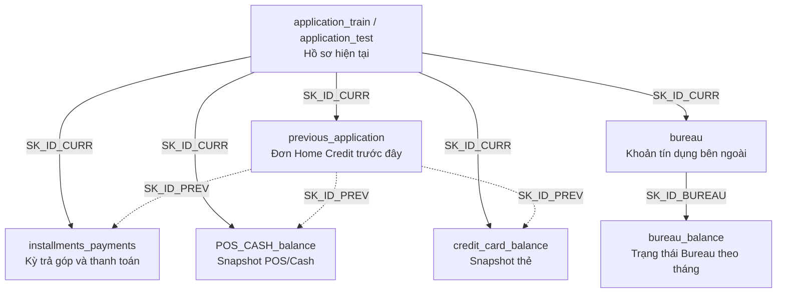

# Hướng dẫn đọc dữ liệu Home Credit Default Risk

Tài liệu này giải thích **các CSV nguồn đang biểu diễn điều gì**, trước khi chuyển chúng thành dimension và fact trong data warehouse. Tên cột được giữ nguyên để đối chiếu trực tiếp với dữ liệu.

## 1. Bối cảnh: đang nhìn một hồ sơ vay và lịch sử liên quan

Home Credit cần đánh giá một hồ sơ vay hiện tại. Bộ dữ liệu cung cấp thông tin người nộp hồ sơ, khoản vay hiện tại và lịch sử tín dụng/thanh toán liên quan đến người đó.

Hãy phân biệt bốn khái niệm:

| Khái niệm | Ví dụ | Nguồn chính |
|---|---|---|
| Hồ sơ vay hiện tại | Người nộp hồ sơ đang xin một khoản vay | `application_train/test` |
| Đơn vay trước đây | Từng xin vay mua điện thoại; đơn có thể được duyệt hoặc từ chối | `previous_application` |
| Kỳ trả góp và lần thanh toán | Kỳ số 3 phải trả 1.000; trả hai lần 400 và 600 | `installments_payments` |
| Snapshot theo tháng | Tháng trước, tài khoản thẻ có số dư 25.000 | Các bảng `*_balance` |

**Đơn vay không đồng nghĩa khoản vay đã giải ngân. Một kỳ trả góp không đồng nghĩa một lần thanh toán. Snapshot không đồng nghĩa giao dịch.**

Trong project, có thể gọi `SK_ID_CURR` là đầu mối khách hàng/hồ sơ để thuận tiện. Tuy nhiên, từ điển nguồn định nghĩa nó là **ID khoản vay trong mẫu**, không chứng minh đây là mã khách hàng lâu dài của Home Credit.

## 2. Các file và quy mô

Số dòng dưới đây được kiểm tra trên toàn bộ các CSV của repository trong đợt review ngày 13/10/2026; chưa áp dụng bộ lọc khách hàng train.

| Đường dẫn tương đối từ `data_set/` | Số dòng dữ liệu | Số cột | Nội dung |
|---|---:|---:|---|
| `home-credit-default-risk/application_train.csv` | 307.511 | 122 | Hồ sơ hiện tại, có nhãn kết quả |
| `home-credit-default-risk/application_test.csv` | 48.744 | 121 | Hồ sơ hiện tại, không có nhãn kết quả |
| `previous_application.csv` | 1.670.214 | 37 | Các đơn Home Credit trước đây |
| `installments_payments.csv` | 13.605.401 | 8 | Thông tin kỳ trả góp và thanh toán |
| `POS_CASH_balance.csv` | 10.001.358 | 8 | Snapshot POS/Cash theo tháng |
| `credit_card_balance.csv` | 3.840.312 | 23 | Snapshot thẻ tín dụng theo tháng |
| `bureau.csv` | 1.716.428 | 17 | Các khoản tín dụng bên ngoài |
| `bureau_balance.csv` | 27.299.925 | 3 | Trạng thái Bureau theo tháng |

Các file hỗ trợ:

- `HomeCredit_columns_description.csv`: từ điển cột; có một bản ở `data_set/` và một bản trong `home-credit-default-risk/`. Hai bản hiện giống nhau. Đọc bằng pandas với `encoding="cp1252"`; giải mã UTF-8 nghiêm ngặt không đọc được bản hiện tại.
- `home-credit-default-risk/sample_submission.csv`: mẫu nộp dự đoán cho cuộc thi Kaggle, không phải dữ liệu lịch sử hay kết quả thực tế.

## 3. Ba ID cần nhớ và sơ đồ liên kết

| ID | Nhận diện | Xuất hiện ở đâu? |
|---|---|---|
| `SK_ID_CURR` | Hồ sơ/khoản vay hiện tại trong mẫu | Application và các nguồn lịch sử, trừ `bureau_balance` |
| `SK_ID_PREV` | Đơn/khoản Home Credit trước đây | Previous application, installments, POS/Cash, credit card |
| `SK_ID_BUREAU` | Khoản tín dụng bên ngoài | Bureau và bureau balance |



Mũi tên biểu diễn **cột dùng để liên kết**, không phải ràng buộc foreign key đã được đảm bảo. Đường nét đứt nhấn mạnh rằng các bảng thanh toán/tháng có thể thiếu bản ghi tương ứng trong `previous_application`, dù vẫn biết `SK_ID_CURR`.

Một hồ sơ hiện tại có thể liên quan đến nhiều đơn cũ và nhiều khoản Bureau; một khoản có thể có nhiều kỳ hoặc nhiều snapshot tháng. Không dùng `SK_ID_PREV` để join Bureau: hai loại ID thuộc hai miền khác nhau.

## 4. Hồ sơ hiện tại: `application_train` và `application_test`

**Một dòng:** một hồ sơ vay hiện tại, nhận diện bằng `SK_ID_CURR`.

Các nhóm thông tin tiêu biểu:

- Đặc điểm người nộp hồ sơ: `CODE_GENDER`, `DAYS_BIRTH`, `NAME_EDUCATION_TYPE`, `NAME_FAMILY_STATUS`, `OCCUPATION_TYPE`.
- Thu nhập và nơi làm việc: `AMT_INCOME_TOTAL`, `NAME_INCOME_TYPE`, `ORGANIZATION_TYPE`, `DAYS_EMPLOYED`.
- Khoản vay: `NAME_CONTRACT_TYPE`, `AMT_CREDIT`, `AMT_ANNUITY`, `AMT_GOODS_PRICE`.
- Thời điểm nộp: `WEEKDAY_APPR_PROCESS_START`, `HOUR_APPR_PROCESS_START`; không có ngày lịch đầy đủ từ hai cột này.
- Điểm ngoài: `EXT_SOURCE_1/2/3` là các score đã chuẩn hóa từ nguồn ngoài, không tự hiểu là xác suất vỡ nợ.

### Ý nghĩa `TARGET`

`TARGET=1` nghĩa là có khó khăn thanh toán: trễ hơn X ngày ở ít nhất một trong Y kỳ đầu của khoản vay hiện tại. Từ điển không cung cấp giá trị cụ thể của X và Y. `TARGET=0` là các trường hợp còn lại theo định nghĩa đó.

Trong train có 24.825 dòng `TARGET=1`, khoảng 8,07%. Đây là **nhãn có sẵn**, không phải quyết định duyệt đơn, không phải nhãn cho từng khoản vay cũ, và không phải đầu vào hợp lệ của một mô hình dự đoán chính nhãn này.

Train và test của Kaggle là hai tập hồ sơ khác nhau, không phải hai bản trước/sau của cùng hồ sơ. Kiểm tra hiện tại không thấy `SK_ID_CURR` giao nhau. Test không có `TARGET`: không được điền thiếu thành `0`.

**Có thể phân tích:** tỷ lệ khó khăn thanh toán theo nhóm tuổi, loại thu nhập hoặc loại hợp đồng; phân bố số tiền vay và score.

## 5. Đơn vay cũ: `previous_application.csv`

**Một dòng:** một đơn Home Credit trước đây, nhận diện bằng `SK_ID_PREV`, liên quan đến hồ sơ hiện tại qua `SK_ID_CURR`.

| Cột | Cách hiểu |
|---|---|
| `NAME_CONTRACT_STATUS` | Kết quả/trạng thái đơn: `Approved`, `Refused`, `Canceled`, `Unused offer` |
| `AMT_APPLICATION` | Số tiền khách đề nghị |
| `AMT_CREDIT` | Số tiền tín dụng cuối cùng ghi nhận trong đơn |
| `AMT_DOWN_PAYMENT` | Tiền trả trước |
| `CNT_PAYMENT` | Số kỳ/term ghi nhận tại thời điểm đơn cũ |
| `NAME_PORTFOLIO` | Nhóm danh mục như Cash, POS, Cards |
| `NAME_PRODUCT_TYPE` | Phân loại như `x-sell`, `walk-in` |
| `NAME_GOODS_CATEGORY` | Loại hàng hóa liên quan |
| `DAYS_DECISION` | Ngày quyết định, tương đối với hồ sơ hiện tại |

Không coi mọi dòng là khoản vay đang hoạt động. Đơn bị từ chối/hủy vẫn là lịch sử có ích. `AMT_CREDIT` không đủ để chứng minh số tiền thực tế đã giải ngân.

Một số cột `DAYS_FIRST_*`, `DAYS_LAST_*`, `DAYS_TERMINATION` có giá trị đặc biệt `365243`. Phải xác định quy tắc xử lý trước khi dùng làm ngày hoặc khoảng thời gian; không diễn giải máy móc thành hàng trăm nghìn ngày trong tương lai.

**Có thể phân tích:** tỷ lệ duyệt/từ chối đơn cũ, số lần xin vay, số tiền đề nghị so với tín dụng ghi nhận.

## 6. Kỳ trả góp và thanh toán: `installments_payments.csv`

**Một dòng:** thông tin thanh toán gắn với một kỳ của một lịch trả góp. Một kỳ có thể có nhiều dòng vì trả thành nhiều phần; một số dòng thiếu ngày và tiền thanh toán.

Khóa nhận diện một kỳ quan sát:

```text
(SK_ID_PREV, NUM_INSTALMENT_VERSION, NUM_INSTALMENT_NUMBER)
```

| Cột | Cách hiểu |
|---|---|
| `NUM_INSTALMENT_VERSION` | Version lịch trả góp; version 0 dành cho thẻ tín dụng |
| `NUM_INSTALMENT_NUMBER` | Số thứ tự kỳ trong version |
| `DAYS_INSTALMENT` | Ngày đến hạn tương đối |
| `AMT_INSTALMENT` | Số tiền phải trả của kỳ |
| `DAYS_ENTRY_PAYMENT` | Ngày thanh toán thực tế tương đối |
| `AMT_PAYMENT` | Số tiền thực trả được ghi nhận ở dòng |

Ví dụ sau **là minh họa tự tạo, không phải trích từ CSV**:

| `SK_ID_PREV` | Version | Kỳ | Due day | Scheduled | Payment day | Paid |
|---:|---:|---:|---:|---:|---:|---:|
| 5001 | 1 | 3 | -10 | 1.000 | -12 | 400 |
| 5001 | 1 | 3 | -10 | 1.000 | -8 | 600 |

Kỳ này phải trả **1.000**, thực trả **400 + 600 = 1.000**; không cộng scheduled thành 2.000. Khách trả trước hạn một phần, hoàn tất vào ngày -8, tức trễ 2 ngày so với hạn -10.

Toàn file có 12.951.918 nhóm kỳ, trong đó 640.905 nhóm có nhiều dòng. Có 2.905 kỳ thiếu payment amount và payment day; thiếu thông tin không tự chứng minh đã trả 0.

Version thay đổi có thể phản ánh thay đổi lịch thanh toán. Giữ version để phân biệt bản ghi, nhưng cần quy tắc nghiệp vụ trước khi cộng các nghĩa vụ qua nhiều version. Không suy rằng CSV chứa đầy đủ mọi kỳ dự kiến của mọi khoản vay.

**Có thể phân tích:** số kỳ trả trễ, mức thiếu tiền và hành vi trả từng phần, trong phạm vi lịch sử quan sát được.

## 7. Snapshot POS/Cash: `POS_CASH_balance.csv`

POS ở đây là nhóm khoản tín dụng gắn với point of sale; file chứa các snapshot khoản POS/Cash trước đây, không phải danh sách giao dịch máy POS.

**Một dòng:** một `SK_ID_PREV` tại một `MONTHS_BALANCE`.

- `CNT_INSTALMENT`: term/số kỳ của khoản vay, có thể thay đổi theo thời gian.
- `CNT_INSTALMENT_FUTURE`: số kỳ còn phải trả tại snapshot.
- `NAME_CONTRACT_STATUS`: trạng thái tại tháng đó.
- `SK_DPD`: số ngày quá hạn.
- `SK_DPD_DEF`: số ngày quá hạn có áp dụng dung sai cho các khoản nợ nhỏ theo định nghĩa nguồn.

File này **không có cột số dư tiền hay số tiền thanh toán**. Ví dụ, hai snapshot lần lượt còn 8 và 7 kỳ không có nghĩa khách còn tổng cộng 15 kỳ: đó là hai thời điểm của cùng khoản vay.

**Có thể phân tích:** diễn biến số kỳ còn lại, trạng thái và mức quá hạn qua các tháng trước hồ sơ hiện tại.

## 8. Snapshot thẻ: `credit_card_balance.csv`

**Một dòng:** một tài khoản/khoản thẻ `SK_ID_PREV` tại một tháng tương đối.

| Cột | Nội dung |
|---|---|
| `AMT_BALANCE` | Số dư tại snapshot |
| `AMT_CREDIT_LIMIT_ACTUAL` | Hạn mức ghi nhận |
| `AMT_DRAWINGS_CURRENT` | Số tiền sử dụng/rút trong tháng |
| `AMT_PAYMENT_TOTAL_CURRENT` | Tổng tiền khách trả trong tháng |
| `AMT_INST_MIN_REGULARITY` | Khoản thanh toán tối thiểu được ghi nhận |
| `AMT_TOTAL_RECEIVABLE` | Tổng khoản phải thu tại snapshot |
| `NAME_CONTRACT_STATUS`, `SK_DPD`, `SK_DPD_DEF` | Trạng thái và quá hạn |

Phân biệt **số dư tại thời điểm** với **tiền phát sinh trong kỳ**. Số dư 20.000 ở tháng -2 và 25.000 ở tháng -1 không có nghĩa tổng dư nợ là 45.000. Ngược lại, tổng payment qua hai tháng có thể biểu diễn tiền trả trong khoảng đó, nếu không có trùng lặp và phạm vi tháng rõ ràng.

Không cộng các cột tổng và thành phần vào nhau nếu chúng chồng lắp. Không tính tỷ lệ sử dụng hạn mức khi limit bằng 0 mà chưa có quy tắc xử lý.

**Có thể phân tích:** utilization, hành vi sử dụng/trả tiền và quá hạn theo tháng.

## 9. Tín dụng bên ngoài: `bureau.csv`

**Một dòng:** một khoản tín dụng bên ngoài có `SK_ID_BUREAU`, liên quan đến hồ sơ hiện tại qua `SK_ID_CURR`.

Đây là thông tin khoản tín dụng được báo cáo qua Credit Bureau, không phải một đơn xin vay Home Credit.

- `CREDIT_ACTIVE`: trạng thái khoản tín dụng được báo cáo.
- `CREDIT_TYPE`: loại tín dụng.
- `CREDIT_CURRENCY`: tiền tệ ghi nhận cho khoản Bureau.
- `AMT_CREDIT_SUM`: số tiền tín dụng ghi nhận.
- `AMT_CREDIT_SUM_DEBT`: dư nợ ghi nhận.
- `AMT_CREDIT_SUM_OVERDUE`, `CREDIT_DAY_OVERDUE`: tiền và ngày quá hạn.
- `DAYS_CREDIT`: thời điểm xin khoản tín dụng tương đối với hồ sơ hiện tại.
- `DAYS_CREDIT_ENDDATE`: thời gian đến ngày kết thúc dự kiến tại thời điểm hồ sơ hiện tại.
- `DAYS_ENDDATE_FACT`: ngày kết thúc thực tế tương đối, dành cho khoản đã đóng.
- `DAYS_CREDIT_UPDATE`: độ lệch ngày cập nhật thông tin.

`bureau` không phải lịch sử số dư hàng tháng: mỗi khoản chỉ có một dòng trong file hiện tại. Không gán các số tiền ở đây cho mọi tháng của `bureau_balance` để giả lập lịch sử dư nợ.

**Có thể phân tích:** nghĩa vụ tín dụng bên ngoài, khoản đang hoạt động/đã đóng, dư nợ và quá hạn được báo cáo.

## 10. Trạng thái Bureau theo tháng: `bureau_balance.csv`

**Một dòng:** một `SK_ID_BUREAU` tại một `MONTHS_BALANCE`. File chỉ có ba cột: ID, tháng và `STATUS`.

Muốn biết hồ sơ hiện tại liên quan, phải đi qua `bureau`:

```text
bureau_balance.SK_ID_BUREAU
    → bureau.SK_ID_BUREAU
    → bureau.SK_ID_CURR
```

Một số mã theo từ điển nguồn:

| `STATUS` | Ý nghĩa |
|---|---|
| `0` | Không có DPD/quá hạn |
| `1` | Mức quá hạn tối đa trong tháng nằm trong khoảng 1–30 ngày |
| `2` | Quá hạn 31–60 ngày |
| `3`, `4` | Các mức quá hạn cao hơn theo phân loại nguồn |
| `5` | Quá hạn trên 120 ngày hoặc khoản đã bán/xóa nợ theo định nghĩa nguồn |
| `C` | Khoản đã đóng |
| `X` | Trạng thái không biết |

Mã `2` không có nghĩa quá hạn đúng 2 ngày. File không chứa số tiền balance, dù tên có chữ `balance`.

Không phải khoản Bureau nào cũng có lịch sử tháng: trong phạm vi train, có 1.465.325 khoản Bureau nhưng chỉ 523.515 khoản có bản ghi tháng. Không có lịch sử tháng không đồng nghĩa chưa từng quá hạn.

## 11. Cách đọc thời gian tương đối

Mốc **0 là thời điểm hồ sơ vay hiện tại của từng dòng `SK_ID_CURR`**, không phải ngày hôm nay hoặc một ngày lịch chung cho toàn bộ dữ liệu.

```text
Ngày -30       Ngày -12      Ngày -10       Ngày -8          Ngày 0
Quyết định     Thanh toán    Đến hạn       Thanh toán       Hồ sơ hiện tại
đơn cũ         một phần                    phần còn lại
```

- `DAYS_DECISION=-30`: quyết định đơn cũ xảy ra 30 ngày trước mốc hồ sơ hiện tại.
- `DAYS_BIRTH` âm: dùng để tính tuổi xấp xỉ tại hồ sơ hiện tại.
- `MONTHS_BALANCE=-1`: snapshot tháng trước/gần nhất theo định nghĩa nguồn.
- Offset dương có thể hợp lệ cho thời điểm kết thúc dự kiến; không coi mọi giá trị dương là lỗi.

Trong các file hiện có, POS/Cash và thẻ có tháng từ -96 đến -1; Bureau balance từ -96 đến 0. Hai khách cùng có tháng -3 không nhất thiết đang được quan sát trong cùng tháng lịch.

Vì vậy, biểu đồ nên ghi “tháng trước hồ sơ hiện tại”, không tự đặt trục thời gian thành tháng 1/2026, tháng 2/2026. Thuộc tính nghề nghiệp/tuổi từ application cũng là tại hồ sơ hiện tại, không chứng minh giá trị tại thời điểm đơn cũ.

## 12. Những giới hạn cần nhớ khi nối dữ liệu

### Thiếu bảng cha là tình huống có thật

Trong các dòng có `SK_ID_CURR` thuộc train, số dòng không tìm được `SK_ID_PREV` ở previous application là:

| Nguồn | Số dòng thiếu cha |
|---|---:|
| Installments | 1.019.371 |
| POS/Cash | 291.621 |
| Credit card | 872.972 |

Các dòng này vẫn có ID hồ sơ hiện tại, nên không nên mất chỉ vì `INNER JOIN` để lấy thuộc tính sản phẩm. Với Bureau balance, thiếu khoản cha lại khiến không xác định được `SK_ID_CURR`; cần xử lý riêng.

### Join nhiều bảng lịch sử có thể nhân số dòng

Một hồ sơ có 2 đơn cũ và 3 khoản Bureau. Join cả hai nguồn chỉ bằng `SK_ID_CURR` có thể tạo 2 × 3 = 6 dòng. Tổng tiền đơn cũ khi đó bị lặp theo số khoản Bureau.

Để so sánh ở mức hồ sơ, tổng hợp từng nguồn về một dòng mỗi `SK_ID_CURR` trước, rồi mới join các kết quả. Để bổ sung thuộc tính cho account, dùng đúng ID account và kiểm tra quan hệ.

### Thiếu thông tin khác giá trị bằng 0

- Không có lịch sử: chưa quan sát được trong nguồn này, không đủ để kết luận hành vi tốt.
- `NULL` payment: không biết tiền trả, không mặc định là chưa trả.
- `XNA`/`X`: mã nguồn cần mapping theo từng cột.
- `EXT_SOURCE_1` thiếu ở khoảng 56,4% train; không biến missing thành score 0.
- Không tự gán đơn vị tiền là VND. Giữ đơn vị theo nguồn; kiểm tra `CREDIT_CURRENCY` nếu phân tích Bureau theo tiền tệ.

## 13. Phạm vi của project hiện tại

Theo `schema_doc.md`, population phân tích được chọn từ `application_train`. Các file lịch sử chứa nhiều hồ sơ hơn phạm vi đó, nên số dòng sau lọc sẽ nhỏ hơn bảng quy mô ở trên. Đây là lựa chọn của project, không phải đặc tính bắt buộc của bộ dữ liệu.

Với một hồ sơ, cách đọc tự nhiên là: **hồ sơ hiện tại có đặc điểm gì → từng xin những đơn nào → thanh toán các kỳ ra sao → trạng thái tài khoản qua các tháng thế nào → còn có tín dụng bên ngoài nào**. `TARGET` cho phép đối chiếu những lịch sử đó với nhãn khó khăn thanh toán của khoản hiện tại.

Sau khi hiểu các nguồn, mới chốt câu hỏi nghiệp vụ và kiểm tra warehouse giữ đủ thông tin để trả lời chúng. Các vấn đề thiết kế cần quyết định được thảo luận riêng trong review schema.

## Nguồn và cách đọc trong VS Code

- [Từ điển cột gốc](data_set/HomeCredit_columns_description.csv): căn cứ chính cho ý nghĩa cột và mã.
- [Schema dự kiến](schema_doc.md): bản thiết kế warehouse của project; không thay thế định nghĩa nguồn.
- Các số liệu kiểm tra nêu trong tài liệu lấy từ CSV local; cần kiểm tra lại nếu thay bộ dữ liệu.

Mở file này và nhấn **Ctrl+Shift+V** để xem Markdown Preview. Sơ đồ Mermaid cần trình xem có hỗ trợ Mermaid; nếu preview chưa render, phần bảng ID và giải thích vẫn mô tả đầy đủ các quan hệ.
